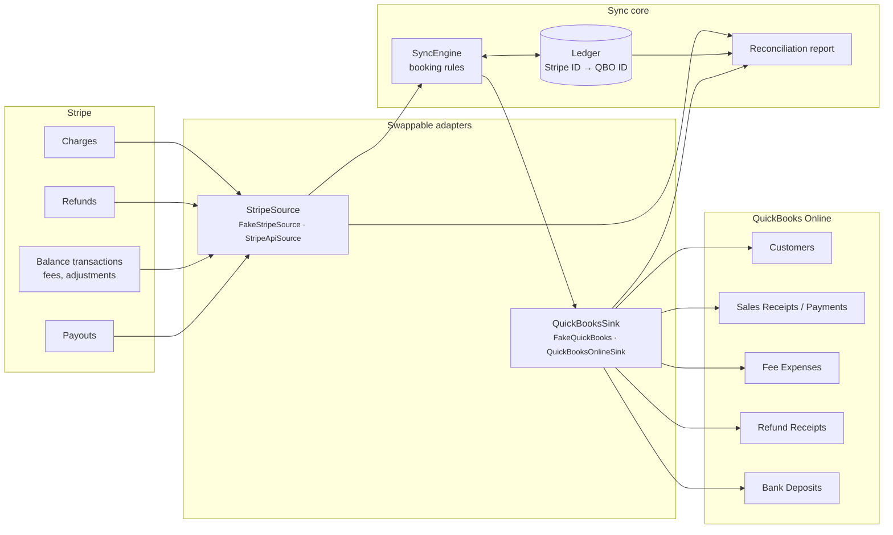

# Stripe → QuickBooks Sync

Turn every Stripe payment, fee, refund and payout into correct QuickBooks Online records automatically, and get a reconciliation report that tells you, to the cent, whether your bank deposits match.

This is a working demo built around a fictional business, **Juniper Lane Clay Studio**, a small pottery studio that sells classes, memberships, gift cards and handmade pieces through Stripe. Everything runs offline against realistic sample data, and the Stripe and QuickBooks adapters are built so the real APIs can be swapped in (see [Going live](#going-live)).

```
uv run stripe-qb sync --since 2026-09-01     # push September into QuickBooks
uv run stripe-qb report                      # check payouts against deposits
```

---

## The problem, in plain English

Stripe deposits money in batches. A Tuesday deposit of **$1,461.28** in the studio's bank account is really sixteen sales (classes, memberships, a gift card, bowls and mugs), a refund for a cancelled course, and sixteen separate Stripe fees adding up to $55.72, all netted together. QuickBooks doesn't know any of that. Someone has to:

1. Type in a sale for every Stripe payment, for the full price (not what landed in the bank).
2. Record the Stripe fee on each one as an expense.
3. Record each refund against the right customer.
4. Make sure the customer exists in QuickBooks, and isn't added twice.
5. Record each payout as a bank deposit and check it matches the bank statement.
6. Work out why it doesn't match when a chargeback quietly took $80 out of a payout.

Get it wrong and your revenue is understated, fees are missing from your expenses, and bank reconciliation becomes a monthly puzzle.

### Before and after

| | By hand | With this sync |
|---|---|---|
| September at the studio: 81 payments, 3 refunds, 4 payouts, 1 chargeback | ~6–7 hours of data entry and reconciliation\* | about 1 second, then a few minutes reviewing 1 flagged item |
| Revenue booked at | whatever landed in the bank (net of fees), often | full sale price, with fees as a separate expense |
| Payout reconciliation | spreadsheet + bank statement + Stripe dashboard | one report, mismatches explained line by line |
| Running it twice | duplicate sales | nothing happens: every record is keyed on its Stripe ID |
| Something unusual (chargeback, invoice overpayment) | discovered at month end, maybe | flagged the day it happens, never guessed at |

\* Estimate: ~3 minutes per payment for a sale plus its fee, ~5 per refund, ~20 per payout to match against the bank, plus month-end clean-up.

---

## How it books things

It uses the *clearing account* method that most bookkeepers use for Stripe. A bank-type account called **Stripe Clearing** stands for "money Stripe is holding for us":

| Stripe | QuickBooks record | Money moves |
|---|---|---|
| Charge | **Sales Receipt** for the full amount | into Stripe Clearing |
| Charge paying an existing invoice (`metadata.qbo_invoice`) | **Payment** applied to that invoice | into Stripe Clearing |
| Stripe fee on a charge | **Expense** (Purchase) to *Stripe Fees*, vendor *Stripe* | out of Stripe Clearing |
| Refund (full or partial) | **Refund Receipt** to the same customer | out of Stripe Clearing |
| Payout | **Bank Deposit** with one line per Stripe transaction it settled | Stripe Clearing → Business Checking |
| Anything else (chargebacks, adjustments) | nothing; flagged for a human | — |

After each payout lands, Stripe Clearing holds exactly what's still sitting in Stripe, and every deposit equals the bank deposit. The test suite checks both of those against the sample month.

**Customers** are matched by email (case-insensitive), including guest checkouts that only have a billing email. If none matches, a customer is created. If that name already belongs to a *different* person, the new customer becomes `Sam Patel (sam.patel@example.net)` rather than being merged into the wrong record.

**Reruns are safe.** Every write is keyed on its Stripe ID in a small SQLite ledger (`charge:ch_…`, `fee:txn_…`, `refund:re_…`, `payout:po_…`). Every create also sends QuickBooks a deterministic `requestid`, so even if the ledger is lost or the process dies halfway through, replaying the sync can't post anything twice.

**It doesn't guess.** A chargeback, an invoice that doesn't exist, or a payment larger than the invoice's open balance is reported as *needs review* instead of being booked somewhere plausible.

---

## Architecture



```
src/stripe_qb_sync/
  models.py            normalized Stripe objects (integer cents, no floats)
  sources/base.py      StripeSource protocol
  sources/fake.py      offline Stripe backed by sample_data/stripe.json
  sources/stripe_api.py  real Stripe adapter (reference, not called by tests)
  sinks/base.py        QuickBooksSink protocol
  sinks/fake.py        offline QuickBooks company (ids, requestid, duplicate names, invoice balances)
  sinks/qbo_api.py     real QuickBooks Online adapter (reference, not called by tests)
  engine.py            booking rules
  ledger.py            SQLite idempotency ledger
  report.py            payout ↔ deposit reconciliation
  sample_data.py       deterministic data generator (fixed seed)
  cli.py               stripe-qb sync / report / generate / reset
```

The engine only talks to the two protocols, so swapping the fakes for real APIs changes no booking logic. Both real adapters build the same normalized objects / QuickBooks JSON as the fakes.

---

## Run it

Requires Python 3.11+ and [uv](https://docs.astral.sh/uv/) (or plain `pip install -e .`). No accounts or API keys needed.

```bash
uv run stripe-qb sync --since 2026-09-01
```

```bash
uv run stripe-qb report
```

```bash
uv run pytest
```

Other commands: `stripe-qb reset` (start over from the QuickBooks seed), `stripe-qb generate --seed N` (rewrite the sample data), `stripe-qb report --strict` (exit 1 if anything needs attention, for cron/CI alerts).

### Sample output

First sync of September:

```
Synced Stripe activity since 2026-09-01 into QuickBooks

  Customers matched to existing QuickBooks customers     1
  Customers created                                     37
  Sales receipts created                                80
  Invoice payments applied                               1
  Stripe fee expenses recorded                          81
  Refund receipts created                                3
  Bank deposits created (payouts)                        3
  Already synced, skipped                                0
  Failed/incomplete charges ignored                      2
  Payouts not yet arrived                                1

  Needs review (1):
    ! po_UQz2nsoHBxboZgdHyqSYm79F: adjustment txn_6ivqKskhul87QZuhCxR8ZbsR (-$80.00, 'Chargeback withholding for ch_Ln1oc7z9CU0dWGspvjOug5mG') has no automatic booking rule; deposit will not match until it is booked
```

Running it again changes nothing:

```
  Sales receipts created                                 0
  ...
  Bank deposits created (payouts)                        0
  Already synced, skipped                               87
```

The reconciliation report:

```
Stripe payouts vs QuickBooks deposits (payouts arriving on/after 2026-09-01)

Payout                      Arrives         Stripe  QuickBooks      Diff  Status
--------------------------------------------------------------------------------------
po_4aiFO15fV1ClZIbLhUzPaZ99 2026-09-09   $1,218.31   $1,218.31            OK
po_c5BwjNZgBvif35vJuCLoS6e1 2026-09-16   $1,461.28   $1,461.28            OK
po_UQz2nsoHBxboZgdHyqSYm79F 2026-09-23   $2,023.38   $2,103.38    $80.00  MISMATCH
                             ↳ Unbooked adjustment txn_6ivqKskhul87QZuhCxR8ZbsR -$80.00: Chargeback withholding for ch_Ln1oc7z9CU0dWGspvjOug5mG
po_wTqdumN22e7NTmCX6sJFf0gg 2026-09-30   $1,440.51           -            IN TRANSIT
                             ↳ Stripe status: in_transit
--------------------------------------------------------------------------------------
Arrived payouts                          $4,702.97   $4,782.97    $80.00

1 payout(s) need attention before the books will reconcile.
```

The September 23 payout was $80 short because a customer disputed a $65 workshop and Stripe withheld it plus a $15 dispute fee. The report names the exact Stripe transaction, so whoever closes the books knows what to record. Other things it catches: a deposit edited or deleted in QuickBooks, a payout that was never synced, and a payout that includes charges QuickBooks has no record of.

### What's in the sample data

`sample_data/` is produced by `sample_data.py` with a fixed seed, so every run and every test sees the same month. All people are made up and all emails use the reserved `example.com/.net/.org` domains.

- **Stripe** (`stripe.json`, shaped like real API responses): 23 customers plus guest checkouts, 83 charges (2 declined), full, partial and post-cutoff refunds, per-charge fees at 2.9% + 30¢, a chargeback adjustment, a wholesale invoice paid by card, and four weekly payouts (the last still in transit).
- **QuickBooks** (`quickbooks_seed.json`): the studio's books before automation, with a chart of accounts, existing customers (one with different email casing, one sharing a name with a different Stripe customer), open and paid wholesale invoices, and some manual August entries that the sync leaves alone.

### Tests

41 tests, all offline, in under a second:

| Area | What's covered |
|---|---|
| Idempotency | reruns, overlapping `--since` windows, a deleted ledger, a crash halfway through then a retry |
| Fees | gross sale + separate fee expense, cent-exact rounding, zero-fee charges, net deposit lines |
| Refunds | full, partial, refunds inside a payout, refunds of charges from before the sync window |
| Payouts | payouts that settle charges from before `--since`, pending balances left in clearing, in-transit → paid |
| Mismatch detection | unbooked chargeback, deposit edited in QuickBooks, deposit deleted, payout never synced |
| Customers & invoices | case-insensitive email match, same-name collisions, guest checkouts, invoice payments, bad invoice refs |
| Books balance | Stripe Clearing equals money still at Stripe; Checking equals the deposits |

---

## Going live

The demo never calls a real API. To point it at a Stripe test account and a QuickBooks Online sandbox:

**1. Install the live extras** (`stripe`, `requests`)

```bash
uv sync --extra live
```

**2. Stripe (test mode).** In the Stripe Dashboard, with *Test mode* on, create a restricted key with **read** access to Charges, Refunds, Payouts, Balance and Customers.

| Variable | Value |
|---|---|
| `STRIPE_API_KEY` | `rk_test_…` or `sk_test_…` |
| `STRIPE_ALLOW_LIVE` | leave unset; the adapter refuses live keys unless this is `1` |

**3. QuickBooks Online sandbox.** At developer.intuit.com, create an app with the `com.intuit.quickbooks.accounting` scope and a sandbox company. Use the OAuth 2.0 Playground (or your own connect flow) to get a refresh token for that company.

| Variable | Value |
|---|---|
| `QBO_CLIENT_ID` / `QBO_CLIENT_SECRET` | the app's development keys |
| `QBO_REFRESH_TOKEN` | from the OAuth flow |
| `QBO_REALM_ID` | the sandbox company ID |
| `QBO_ENVIRONMENT` | `sandbox` (default) or `production` |

**4. One-time QuickBooks setup.** Create these in the company. The sync stops with a clear error that names anything missing:

- Bank account **Stripe Clearing** and bank account **Business Checking**
- Expense account **Stripe Fees**
- Service item **Online Sales** (income account of your choice)
- Vendor **Stripe**

Different names? Pass a `QuickBooksSetup(...)` to `SyncEngine`.

**5. Run against the real services**

```bash
SYNC_SOURCE=stripe SYNC_SINK=qbo uv run stripe-qb sync --since 2026-09-01
```

```bash
SYNC_SOURCE=stripe SYNC_SINK=qbo uv run stripe-qb report --strict
```

(Or use the `--source stripe --sink qbo` flags.) Keep `.sync-state/ledger.sqlite` somewhere durable: it is the record of what has been synced.

**6. Before production**, the usual hardening for a client engagement:

- Store the rotated QuickBooks refresh token after each refresh (Intuit issues a new one) in a secret store.
- Run on a schedule (nightly cron or a `payout.paid` webhook) with `report --strict` wired to email/Slack.
- Add booking rules the business needs: dispute losses/wins, Stripe Billing invoices, multi-currency, Stripe Connect.
- Respect QuickBooks' API rate limits and add retry with backoff (requestids already make retries safe).

> The two live adapters (`sources/stripe_api.py`, `sinks/qbo_api.py`) are reference implementations of the same interfaces. The offline test suite does not exercise them. Validate them against your own test-mode and sandbox accounts first.
